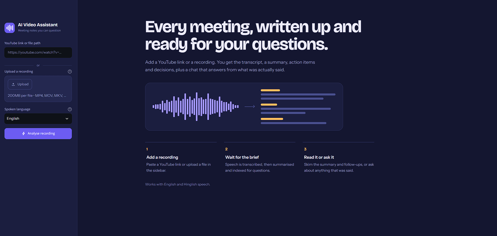
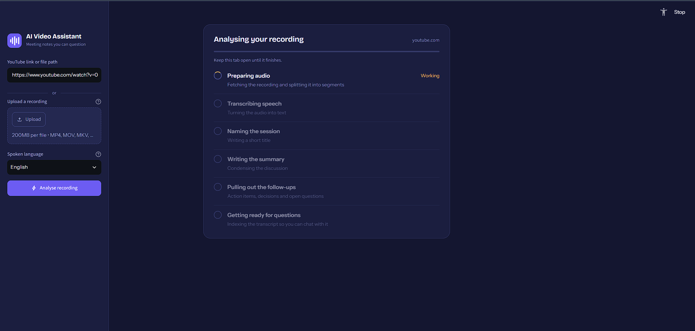

<div align="center">

# 🌊 Askwave

### Every meeting, written up and ready for your questions.

Turn any YouTube video or meeting recording into a transcript, a structured summary, action items, key decisions, and open questions, then **chat with it** using RAG.


</div>

---

## 📖 Overview

**Askwave** is an AI Video Assistant that converts long meetings and videos into notes you can actually use. Paste a YouTube link or upload a recording, and Askwave:

1. Extracts and processes the audio
2. Transcribes the speech (English, Hindi, and Hinglish)
3. Generates a title, summary, action items, key decisions, and open questions
4. Indexes the transcript so you can **ask questions and get answers grounded in what was actually said**

No more scrubbing through a 3-hour recording to find one decision.

---

## 🖼️ Screenshots

| Home | Processing |
|------|-----------|
|  |  |

> Save your screenshots in an `assets/` folder as `home.png` and `processing.png` so the images render on GitHub.

---

## ✨ Features

- 🔗 **Flexible input**: any YouTube URL or local audio/video file (MP4, MOV, MKV, and more, up to 200MB per file)
- 🎙️ **English transcription** using local OpenAI Whisper (free, runs on your machine)
- 🇮🇳 **Hindi and Hinglish transcription** using Sarvam AI, with translation to clean English
- 📋 **Bullet-point summary** of the full meeting
- ✅ **Action items** with owner and deadline
- 🔑 **Key decisions** made during the meeting
- ❓ **Open questions and follow-ups**
- 💬 **Chat with your meeting** using RAG over ChromaDB
- 📄 **Export** the full report as PDF or TXT
- 🖥️ **Clean Streamlit UI** with live progress tracking

---

## 🛠️ Tech Stack

| Layer | Technology |
|-------|-----------|
| Language | Python |
| Speech-to-text (English) | OpenAI Whisper (local, free) |
| Speech-to-text (Hindi/Hinglish) | Sarvam AI |
| LLM | Mistral AI (free API) |
| Orchestration | LangChain (LCEL) |
| Vector database | ChromaDB |
| Embeddings | HuggingFace (local, free) |
| UI | Streamlit |

---

## 🧠 How It Works

```
 YouTube URL / File
        │
        ▼
 ┌───────────────┐   ┌────────────────┐   ┌──────────────────┐
 │ Audio Extract │──▶│ Chunk & Clean  │──▶│  Transcription   │
 │ (from video)  │   │  (optimize)    │   │ Whisper / Sarvam │
 └───────────────┘   └────────────────┘   └────────┬─────────┘
                                                   │
                         (Hindi/Hinglish → English translation)
                                                   │
                  ┌────────────────────────────────┼───────────────────────┐
                  ▼                                ▼                       ▼
          Title + Summary                 Action Items /             Embeddings
          (LangChain + Mistral)        Decisions / Questions     (HuggingFace → ChromaDB)
                                                                           │
                                                                           ▼
                                                                  RAG Chat Engine
```

---

## 📁 Project Structure

```
askwave/
├── main.py                  # Pipeline orchestration + CLI entry point
├── app.py                   # Streamlit UI
├── requirements.txt
├── .env                     # API keys (not committed)
├── core/
│   ├── transcriber.py       # Speech-to-text (Whisper / Sarvam)
│   ├── translator.py        # Hindi/Hinglish → clean English
│   ├── summarizer.py        # Title + structured summary
│   ├── extractor.py         # Action items, decisions, open questions
│   ├── vector_store.py      # Embeddings + ChromaDB storage
│   └── rag_engine.py        # Retrieval-Augmented Generation chain
└── utils/
    └── audio_processor.py   # Audio extraction, chunking, optimization
```

---

## 🚀 Getting Started

### Prerequisites

- Python 3.10+
- [FFmpeg](https://ffmpeg.org/download.html) installed and available on your `PATH`
- A [Mistral AI](https://console.mistral.ai/) API key
- A [Sarvam AI](https://www.sarvam.ai/) API key (only needed for Hindi/Hinglish)

### Installation

```bash
# 1. Clone the repository
git clone https://github.com/<your-username>/askwave.git
cd askwave

# 2. Create and activate a virtual environment
python -m venv venv
source venv/bin/activate        # macOS / Linux
venv\Scripts\activate           # Windows

# 3. Install dependencies
pip install -r requirements.txt
```

### Configuration

Create a `.env` file in the project root:

```env
MISTRAL_API_KEY=your_mistral_api_key
SARVAM_API_KEY=your_sarvam_api_key
```

> ⚠️ Never commit your `.env` file. Make sure it is listed in `.gitignore`.

---

## ▶️ Usage

### Web app (recommended)

```bash
streamlit run app.py
```

Then:

1. Paste a YouTube link **or** upload a recording in the sidebar
2. Choose the spoken language (English / Hinglish)
3. Click **Analyse recording**
4. Read the summary and follow-ups, or ask questions in the chat
5. Export the report as PDF or TXT

### Command line

```bash
python main.py
```

You will be prompted for a YouTube URL or file path and a language, then dropped into an interactive chat with your meeting.

### Use as a library

```python
from main import run_pipeline
from core.rag_engine import ask_question

result = run_pipeline("https://www.youtube.com/watch?v=...", language="english")

print(result["title"])
print(result["summary"])
print(result["action_items"])

answer = ask_question(result["rag_chain"], "What was decided about the launch date?")
print(answer)
```

`run_pipeline` returns a dictionary with: `title`, `transcript`, `summary`, `action_items`, `key_decisions`, `open_questions`, and `rag_chain`.

---

## 🗺️ Roadmap

- [ ] Speaker diarization (who said what)
- [ ] Timestamped chapters and answer citations
- [ ] Support for more Indian languages
- [ ] Persistent chat history across sessions
- [ ] Docker image for one-command setup

---

## 🤝 Contributing

Contributions are welcome.

1. Fork the repo
2. Create a feature branch: `git checkout -b feature/your-feature`
3. Commit your changes: `git commit -m "Add your feature"`
4. Push the branch: `git push origin feature/your-feature`
5. Open a Pull Request

---

## 📜 License

Distributed under the MIT License. See `LICENSE` for details.

---

<div align="center">

Built with ❤️ using Python, LangChain, Mistral AI, and Streamlit.

⭐ If Askwave helps you, consider starring the repo!

</div>